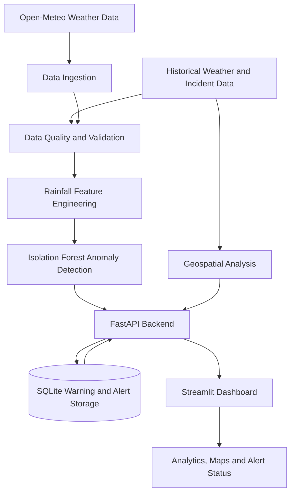

# GeoSentinel AI

**GeoAI-Powered Urban Waterlogging Intelligence & Early Warning Platform**

GeoSentinel AI is a machine learning and geospatial intelligence prototype designed to analyze rainfall patterns, explore urban flooding hotspots, and support location-aware risk monitoring. The initial geographic focus is Hyderabad, Telangana, India.

The platform combines weather data ingestion, rainfall feature engineering, anomaly detection, geospatial analysis, a FastAPI backend, and an interactive Streamlit dashboard.

> **Disclaimer:** GeoSentinel AI is a research and demonstration prototype. It is not a validated flood-prediction system or an emergency warning service.

## 1. Problem Statement

Urban waterlogging can disrupt transportation, damage infrastructure, and threaten public safety. Understanding these risks requires combining weather observations, historical incident information, geographic data, and changing environmental conditions.

GeoSentinel AI explores how machine learning and geospatial analysis can help organize these signals, identify unusual rainfall patterns, and present useful environmental indicators through a unified dashboard.

## 2. Project Objectives

- Analyze historical and available current weather observations.
- Engineer rainfall-related features for machine learning.
- Detect unusual rainfall patterns using anomaly detection.
- Analyze geographic flooding-related records and potential hotspots.
- Provide an interactive dashboard for environmental intelligence.
- Maintain warning history and manage alert lifecycles.
- Track data quality, provenance, and model limitations.
- Develop a modular foundation for future risk-prediction capabilities.

## 3. Technology Stack

| Component | Technology |
|---|---|
| Programming language | Python |
| Backend API | FastAPI |
| Interactive dashboard | Streamlit |
| Machine learning | scikit-learn |
| Data processing | pandas, NumPy |
| Weather data | Open-Meteo |
| Geospatial data | GeoJSON and geospatial Python libraries |
| Local persistence | SQLite |
| API documentation | Swagger UI / OpenAPI |
| Automated testing | pytest |
| Configuration | Environment variables |
| Version control | Git and GitHub |

PostgreSQL/PostGIS, MLflow, Prometheus, Grafana, Docker Compose, and Kubernetes are potential future enhancements, not claimed as integrated components of the current prototype.

## 4. System Design and Architecture

GeoSentinel AI follows a modular architecture separating data ingestion, data preparation, machine learning, geospatial processing, API services, persistence, and visualization.

### High-Level Architecture



### Architecture Components

**1. Data ingestion**

- Retrieves available weather observations from Open-Meteo.
- Supports historical weather processing and live-weather requests.
- Uses synthetic weather data for controlled testing where applicable.

**2. Data quality and feature engineering**

- Validates input data and checks data quality.
- Prepares rainfall-related features for downstream analysis.
- Separates historical, synthetic, and incident-data workflows.

**3. Machine learning**

- Uses an Isolation Forest baseline to identify unusual rainfall patterns.
- Includes rainfall inference and chronological evaluation modules.
- Presents anomalies as indicators for further investigation rather than proof of flooding.

**4. Geospatial intelligence**

- Processes geographic boundaries and available flooding-related records.
- Analyzes and visualizes potential geographic hotspots.
- Distinguishes historical mapped information from model-derived indicators.

**5. FastAPI backend**

- Exposes application functionality through HTTP endpoints.
- Provides weather, rainfall inference, warning history, geospatial data, and alert-management operations.
- Offers interactive API documentation through Swagger UI.

**6. Persistence**

- Uses SQLite for local warning and alert records.
- Supports alert lifecycle management and duplicate-alert suppression.

**7. Streamlit dashboard**

- Presents rainfall analytics, warning history, geographic information, and alert status.
- Provides interactive visualizations for examining available data and model outputs.

### Typical Data Flow

1. Retrieve weather observations or load prepared datasets.
2. Validate data and engineer rainfall-related features.
3. Apply anomaly detection to identify unusual observations.
4. Perform geospatial analysis on available geographic and incident data.
5. Expose supported results through the API.
6. Store and manage warning or alert records where applicable.
7. Display available results in the dashboard.

### Design Principles

- **Modularity:** Keep data processing, ML, geospatial analysis, API services, and presentation separated.
- **Traceability:** Consider data provenance, quality, and freshness.
- **Privacy:** Use precise user-location information only with appropriate permission.
- **Reliability:** Validate implemented behavior with automated tests.
- **Cost awareness:** Prefer lightweight local development and free data sources where practical.

The current implementation is a prototype. Production authentication, high availability, distributed processing, centralized monitoring, and verified emergency-notification delivery require additional implementation and testing.

## 5. Key Features

### Rainfall Analytics and Machine Learning

- Historical rainfall feature engineering and analysis.
- Isolation Forest-based rainfall anomaly detection.
- Live rainfall inference workflow where supported by available weather data.
- Chronological evaluation and data-quality reporting.

### Geospatial Intelligence

- Exploration of mapped flooding-related records.
- Geographic hotspot analysis and visualization.
- Separation of historical observations from predicted or inferred indicators.

### API and Data Management

- Weather and rainfall inference endpoints.
- Warning history and recording operations.
- Alert evaluation and lifecycle management.
- Duplicate-alert suppression.
- Geospatial hotspot endpoints.

### Interactive Dashboard

- Executive Overview
- Warning History
- Alert Management
- Rainfall Analytics
- Geospatial Intelligence
- Data & Model Status

Feature availability depends on the configured data sources and application state.

## 6. Machine Learning Workflow

The project uses an Isolation Forest baseline to identify unusual patterns in rainfall-related features.

The general workflow is:

1. **Data collection:** Obtain available historical or current weather observations.
2. **Data validation:** Check the quality and structure of the observations.
3. **Feature engineering:** Prepare rainfall-related features.
4. **Anomaly detection:** Identify observations that differ from learned patterns.
5. **Evaluation:** Use chronological evaluation where applicable.
6. **Interpretation:** Present the results alongside data-quality information and limitations.

### Important Distinction

**Rainfall anomaly detection is not the same as waterlogging prediction.**

An unusual rainfall pattern does not confirm that flooding has occurred. A reliable predictive system requires representative training data, verified flood-event labels, suitable geographic and temporal features, independent evaluation, and validation against observed outcomes.

## 7. Project Structure

```text
GeoSentinelAI/
├── app/
│   └── frontend/
│       └── pages/
├── artifacts/
├── data/
│   ├── raw/
│   ├── processed/
│   └── synthetic/
├── scripts/
├── src/
│   ├── data_quality/
│   ├── features/
│   ├── geospatial/
│   ├── ingestion/
│   ├── models/
│   └── storage/
├── tests/
│   └── unit/
├── .env.example
├── .gitignore
├── pytest.ini
├── requirements.txt
└── README.md
```

Generated datasets, local databases, and model artifacts may be excluded from Git. Follow the relevant project scripts to recreate local outputs when necessary.

## 8. Getting Started

### Prerequisites

- Python 3.12
- Git
- Windows PowerShell or a compatible terminal
- Internet connectivity for weather-data requests

### Step 1: Clone the repository

```powershell
git clone https://github.com/ashish-wandhare/GeoSentinelAI.git
cd GeoSentinelAI
```

### Step 2: Create a virtual environment

```powershell
py -3.12 -m venv .venv
```

Activate the environment in PowerShell:

```powershell
.\.venv\Scripts\Activate.ps1
```

If PowerShell blocks script activation, use an appropriate environment activation method for your system rather than changing system-wide security settings unnecessarily.

### Step 3: Install dependencies

```powershell
python -m pip install --upgrade pip
pip install -r requirements.txt
```

### Step 4: Configure the application

Review `.env.example` and the application configuration before starting the services.

Configure any required environment variables according to the actual application settings. Do not commit real API keys, passwords, tokens, or other credentials.

### Step 5: Start the FastAPI backend

From the project root, run:

```powershell
python -m uvicorn src.api:app --reload
```

The API should be available at:

- API base URL: `http://127.0.0.1:8000`
- Swagger documentation: `http://127.0.0.1:8000/docs`
- Alternative API documentation: `http://127.0.0.1:8000/redoc`

Keep this terminal running.

### Step 6: Start the Streamlit dashboard

Open a **second PowerShell terminal** and navigate to the project directory:

```powershell
cd D:\Internship\MyOwnProject\GeoSentinelAI
```

Activate the virtual environment:

```powershell
.\.venv\Scripts\Activate.ps1
```

Start the dashboard:

```powershell
python -m streamlit run src/dashboard.py
```

Open the dashboard in your browser:

`http://localhost:8501`

Keep both the API and dashboard terminals running while using the application.

### Step 7: Verify the backend

With the API running, open another terminal and execute:

```powershell
Invoke-RestMethod http://127.0.0.1:8000/health
```

A successful health response confirms that the health endpoint is responding.

You can also open `http://127.0.0.1:8000/docs` to inspect and test the available endpoints.

### Step 8: Run automated tests

From the project root, with the virtual environment activated:

```powershell
python -m pytest -q
```

The previously reported test result was **72 passed, with 3 warnings**.

Test results may change as the project evolves. Passing tests verify the behavior covered by those tests; they do not establish real-world prediction accuracy.

## 9. API Overview

The following endpoints are part of the current implementation, based on the project development and testing history.

| Endpoint | Purpose |
|---|---|
| `GET /health` | Health check |
| `GET /api/v1/weather/live` | Retrieve available live-weather data |
| `GET /api/v1/weather/location` | Retrieve weather information for coordinates |
| `GET /api/v1/rainfall/location-inference` | Run location-specific rainfall inference |
| `GET /api/v1/rainfall/live-inference` | Run inference using available live rainfall data |
| `POST /api/v1/warnings/record` | Record a warning |
| `GET /api/v1/warnings/history` | Retrieve warning history |
| `GET /api/v1/rainfall/latest` | Retrieve the latest rainfall result |
| `GET /api/v1/geospatial/hotspots` | Retrieve geospatial hotspot information |
| `POST /api/v1/alerts/evaluate` | Evaluate alert conditions |
| `GET /api/v1/alerts/history` | Retrieve alert history |
| `PATCH /api/v1/alerts/{alert_id}/status` | Update an alert's status |

Use Swagger UI at `/docs` for the current request schemas, parameters, and response formats.

## 10. Testing and Validation

The project includes unit tests covering areas such as:

- Configuration and data validation.
- Rainfall feature engineering.
- Synthetic weather data.
- Anomaly detection and evaluation.
- Geospatial hotspot analysis.
- Incident reporting and ML-readiness checks.

Run the test suite using:

```powershell
python -m pytest -q
```

Automated software tests and real-world ML evaluation serve different purposes. Model performance must be evaluated separately against appropriate, independently verified data.

## 11. Data and Model Limitations

- Historical weather observations and synthetic test data must remain distinguishable.
- Historical incident records and mapped locations may have incomplete verification, timestamps, or severity information.
- Weather-data availability, geographic coverage, and freshness affect analysis.
- Anomaly scores indicate unusual patterns, not confirmed flooding.
- Model outputs should not be interpreted as validated estimates of flood probability unless separately established through appropriate evaluation.
- Live GPS, mobile notifications, and external alert delivery should only be described as operational after end-to-end integration and testing.
- The platform does not replace official weather warnings, emergency services, or local-authority guidance.

## 12. Security and Privacy

- Keep secrets and private configuration out of source control.
- Use `.env.example` for placeholders rather than real credentials.
- Obtain permission before accessing precise user-location information.
- Minimize the collection and storage of location data.
- Review the licensing and usage terms of datasets before redistribution.

## 13. Future Enhancements

Potential future improvements include:

- Expanding verified flood-event datasets.
- Evaluating waterlogging-risk models against independently verified events.
- Improving spatial and temporal validation.
- Exploring probabilistic risk estimation when supported by data.
- Introducing ML experiment tracking and operational monitoring.
- Evaluating PostgreSQL/PostGIS for larger geospatial workloads.
- Adding containerized deployment.
- Implementing and testing mobile notification integrations.
- Exploring location-aware monitoring and alert delivery with user consent.

These items are future enhancements unless explicitly implemented and verified.

## 14. License

No project license has been selected yet. Review the licensing conditions of the source datasets and dependencies before choosing a license for this repository.

---

**GeoSentinel AI — Environmental Intelligence**

*Historical prototype · Not an emergency warning service*
